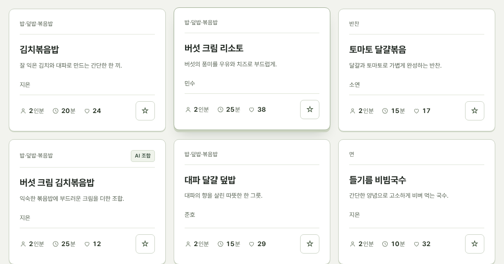
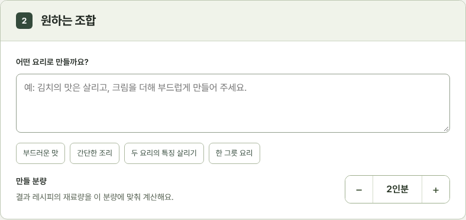
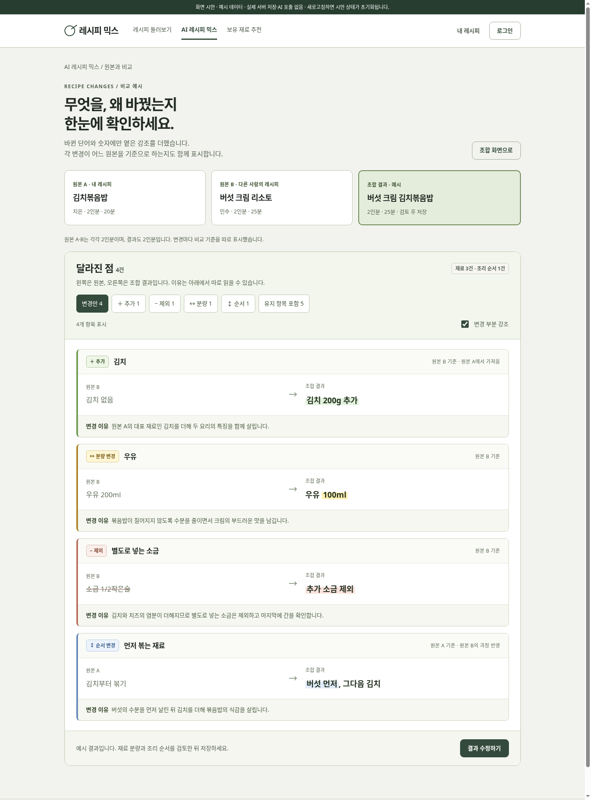
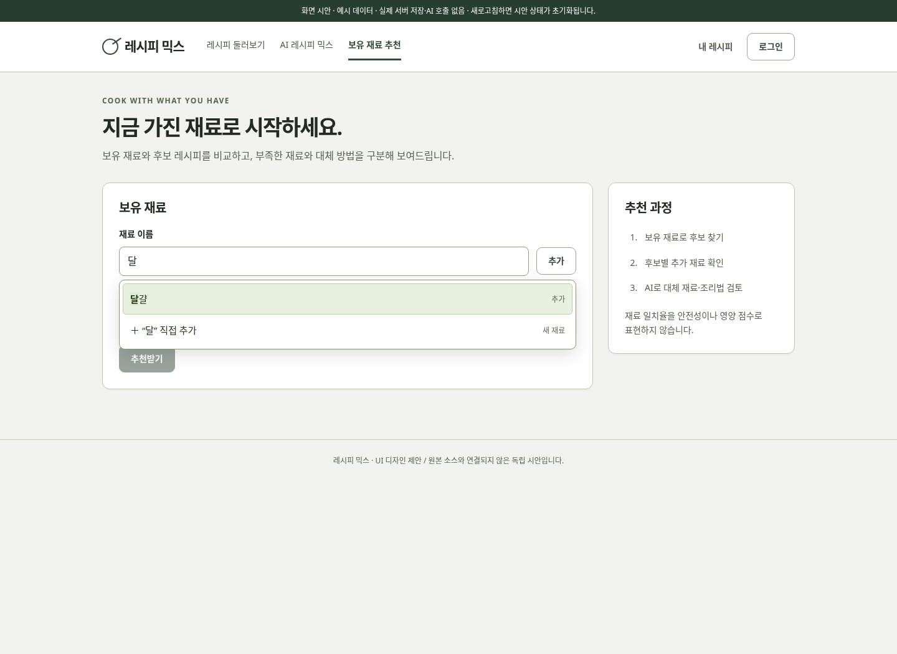

# 레시피 믹스 UI 시안

아이보리·올리브색의 레시피 노트 스타일로 구성한 독립 화면 시안입니다. 실제 Flask 앱·DB·로그인·Gemini API와 연결되지 않습니다. 작성·즐겨찾기·공개 상태는 브라우저 메모리에만 반영되며 새로고침하면 초기화됩니다.

## 열어보기

1. **[시안 ZIP 다운로드](./recipe-mix-preview.zip?raw=true)** 후 **모두 압축 풀기**를 선택합니다.
2. 압축을 푼 폴더의 **`index.html`을 Chrome 또는 Edge로 엽니다.** 브라우저 창에 파일을 끌어놓아도 됩니다.
3. 채팅 앱·파일 앱의 HTML 미리보기 대신 브라우저로 직접 열어 주세요.

GitHub에서 [index.html](./index.html)을 클릭하면 소스 코드가 보이는 것이 정상입니다. 다운로드 버튼으로 파일을 저장한 뒤 열어 주세요. 이 시안에는 별도 설치·서버·API 키가 필요하지 않습니다. 인터넷이 연결돼 있으면 Pretendard 글꼴을 불러오고, 없으면 컴퓨터의 기본 글꼴로 표시됩니다.

스크립트가 차단되거나 초기화 중 오류가 발생하면 기본 시안을 펼쳐 보여주는 대체 표시를 포함했습니다. 대체 표시에서는 버튼 상호작용이 제한될 수 있습니다.

## v4 변경 (읽기 편한 화면)

| 위치 | 바뀐 점 | 이유 |
|---|---|---|
| AI 레시피 믹스 · 만들 분량 | 드롭다운 → 오른쪽 **[− 2인분 ＋]** 버튼 (1~10인분) | 한 번에 1인분씩 바로 조절, 지금 값이 항상 보임 |
| 레시피 상세 · 분량 | 같은 모양의 [− 2인분 ＋] | 화면마다 조작 방법을 통일 |
| 레시피 카드 | 아래쪽에 두께를 주고, **올리면 살짝 떠오르고 누르면 눌려 들어감** | 누를 수 있다는 느낌(입체감). 움직임 줄이기 설정 시 꺼짐 |
| 카드 정보 줄 | `2인분 20분 ♡24` → 선 아이콘 + **진한 숫자** + 연한 단위 | 숫자가 먼저 눈에 들어와 훑어 읽기 쉬움 |
| 글꼴 | Pretendard 를 불러옴 (인터넷이 없으면 기존 글꼴로 표시) | 윈도우 기본 글꼴보다 획이 고르고 덜 피곤함 |
| 자간 | 큰 제목의 자간을 덜 좁힘 (−0.05em → −0.03em) | 한글은 너무 좁히면 글자가 뭉쳐 보임 |
| 작은 글자 | 카테고리 12→13px, 작성자 13→14px | 너무 작은 글자는 읽을 때 피로 |

## 확인할 화면과 기능

| 화면 | 시안에 반영한 내용 |
|---|---|
| 레시피 둘러보기 | 요리 카테고리, 이름·재료 검색, 시간·작성 방식 필터, 최신순·인기순, 즐겨찾기 |
| 레시피 상세 | 재료 준비 체크, 인분별 재료량, 조리 모드, 텍스트 복사, 조합 시작 |
| 등록·내 레시피 | 예시 목록 안에서 등록·수정·삭제·공개 전환, 직접 작성·AI·즐겨찾기 탭 |
| AI 레시피 믹스 | 원본 선택, 조합 목적 예시, 미리 작성한 결과, 편집·개인 보관 |
| 원본과 비교 | 추가·제외·분량·순서 구분, 전후 값, 비교 기준 원본, 변경 이유 |
| 보유 재료 추천 | 재료 자동완성, 동의어, 중복 방지, 직접 추가, 후보 매칭, 부족한 재료, 장보기 목록 복사 |

### 원본 변경 비교

메인 화면의 **원본 변경 비교 시안 보기**를 누릅니다. 바뀐 단어·숫자에만 옅은 형광펜 강조를 사용하고, 유형 이름과 전후 값을 함께 표시합니다.

- **추가:** 연두색, `＋ 추가`
- **제외:** 살구색, `− 제외`
- **분량:** 노란색, `↔ 분량 변경`
- **순서:** 파란색, `↕ 순서 변경`

`변경만`, 유형별 필터, `유지 항목 포함`, `변경 부분 강조` 켜기·끄기를 확인할 수 있습니다. 비교와 AI 결과는 **김치볶음밥 + 버섯 크림 리소토, 최종 2인분**의 고정 예시입니다. 다른 원본을 선택해도 실제 AI 결과가 생성되지는 않습니다.

### 재료 자동완성

**보유 재료 추천**에서 `달`을 입력하면 `달걀`을 추천합니다. `계란`도 표준명 `달걀`로 연결합니다. 방향키·Enter·Escape와 클릭을 지원하고, 이미 추가한 재료의 중복을 방지합니다. 목록에 없는 재료는 직접 추가할 수 있습니다.

모든 재료를 DB에 미리 넣을 필요는 없습니다. 시안은 **작은 기본 재료 목록 + 예시 레시피의 재료명 + 동의어 목록**을 사용합니다. 실제 구현 시 등록된 레시피의 재료명을 중복 제거해 후보로 활용할 수 있습니다. 규모가 커지면 표준 재료와 동의어 테이블로 확장하면 됩니다.

후보 추천은 예시 데이터의 재료 이름 일치를 기준으로 하며, 대체 재료 설명은 실제 AI 판단을 수행하지 않습니다.

## 화면 이미지

- [메인 · 데스크톱](./screenshots/home-desktop.png) / [모바일](./screenshots/home-mobile.png)
- [변경 비교 · 데스크톱](./screenshots/comparison-desktop.png) / [모바일](./screenshots/comparison-mobile.png)
- [자동완성 · 데스크톱](./screenshots/autocomplete-desktop.png) / [모바일](./screenshots/autocomplete-mobile.png)

## 검증 범위

Chromium에서 검색·필터·즐겨찾기·원본 선택·변경 비교·자동완성·장보기 복사·조리 모드·시안 등록 및 공개 상태 전환을 확인했습니다. 모바일 가로 넘침과 정상 실행·스크립트 오류·스크립트 차단 시 화면 표시도 확인했습니다. 사용자의 컴퓨터에서 발생한 흰 화면의 정확한 원인은 확인되지 않았습니다.
