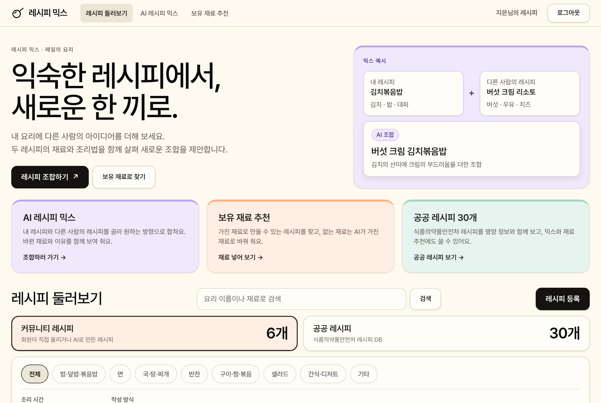
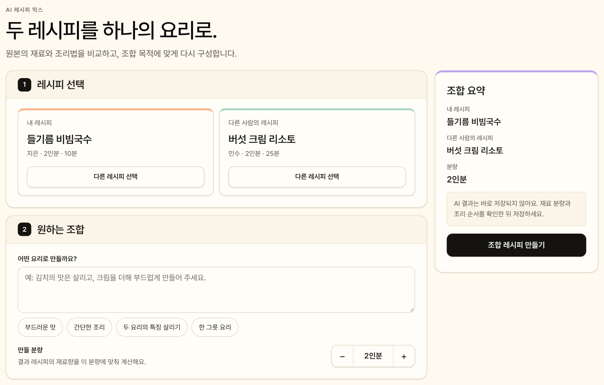
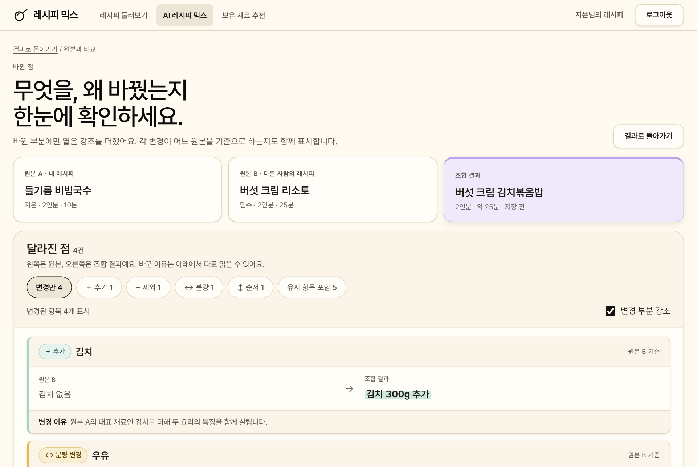
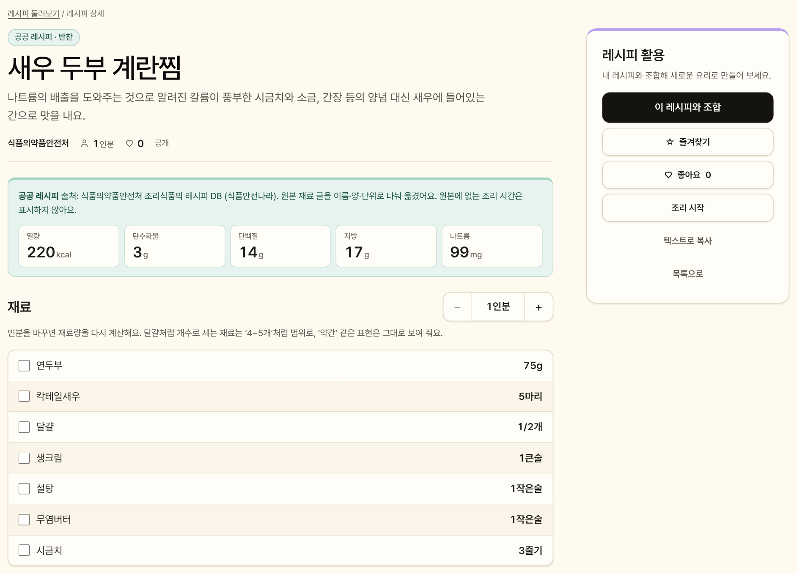

# 레시피 믹스(Recipe Mix) 3회차 제출서

AI 레시피 믹스 커뮤니티 웹서비스 · 소프트웨어개발 3회차 (AI 기능 내장 · 실제 배포) · 2026-11-24

| 제출물 | 위치 |
|---|---|
| 1. 전체 코드 | GitHub https://github.com/EHhwan/software (브랜치 `ccr-51585c03-aolzd2`) · 이 문서 1장 |
| 2. 배포된 서비스 URL | https://recipe-mix-65dy.onrender.com/ · 이 문서 2장 |
| 3. AI 기능 설명 | 이 문서 3장 |
| 4. 검증 기록 | 이 문서 4장 |
| 5. 데모데이 발표 자료 | 별도 파일 |

테스트·화면 점검의 자세한 기록은 저장소의 `docs/보고서.md`(23쪽, 사진 30장)에 있고, 이 문서 부록에 요약했다.

## ● 1. 전체 코드

| 항목 | 내용 |
|---|---|
| 저장소 | https://github.com/EHhwan/software (브랜치 `ccr-51585c03-aolzd2`) |
| 기술 | Python Flask, Flask-Login, Flask-SQLAlchemy, Flask-WTF, Bootstrap 5, SQLite(개발) / PostgreSQL(배포), Google Gemini API(`google-generativeai`, `model.generate_content`), 식품안전나라 OpenAPI |
| 실행 | Windows는 `start.cmd` 더블클릭 (가상환경·패키지 설치 → `.env` 확인 → 서버 실행). 직접: `pip install -r requirements.txt` → `python run.py` |
| 테스트 | `python -m pytest tests -q` → 114건 통과 (SQLite·PostgreSQL 모두) |

| 파일 | 하는 일 |
|---|---|
| `app/ai.py` | Gemini 프롬프트·호출·응답 검증 (서버에서만) |
| `app/mix.py` | AI 레시피 믹스, AI 결과 미리보기·원본과 비교·저장 |
| `app/pantry.py` | 보유 재료 추천(후보는 일반 코드, 대체·조정은 AI), 저장된 재료, 재료 자동완성 |
| `app/public_recipes.py` | 공공 레시피 가져오기 (식품의약품안전처 API → 이름·양·단위로 변환) |
| `app/main.py`, `app/recipes.py`, `app/auth.py` | 둘러보기(커뮤니티·공공 분리, 검색·필터·정렬·페이지), 레시피 등록·수정·삭제·좋아요·즐겨찾기, 회원 |
| `app/models.py` | 사용자, 레시피, 재료, 조리 순서, 좋아요, 즐겨찾기, AI 출처, 저장된 재료 |
| `tests/` | 자동 테스트 114건 (가짜 Gemini 응답, 실제 공공 데이터 30개 포함) |

## ● 2. 배포된 서비스

| 항목 | 내용 |
|---|---|
| URL | **https://recipe-mix-65dy.onrender.com/** |
| 시연 계정 | jieun / minsu / soyeon (비밀번호 demo1234) · 직접 회원가입도 가능 |
| 구성 | 웹 서버 Render(gunicorn, 응답 대기 120초) + DB Neon(무료 PostgreSQL, 만료 없음) |
| 데이터 | 예시 레시피 6개 + 공공 레시피 1,151개(식품의약품안전처) |
| 비밀 값 | Gemini 키·공공 데이터 인증키·DB 주소는 Render 환경변수에만 저장 (GitHub·화면에 없음) |
| 참고 | 무료 플랜은 15분 동안 접속이 없으면 잠들어 첫 접속이 30~60초 걸린다 |

## ● 3. AI 기능 설명

### 3-1. 무엇을 Gemini로 처리했나

| 기능 | Gemini에 주는 것 | Gemini가 돌려주는 것 |
|---|---|---|
| **AI 레시피 믹스** | 내 레시피 + 다른 사람의 레시피(재료·수량·단위·인분·시간·순서), 조합 목표, 만들 분량 | 새 요리 이름·특징, 재료와 정확한 수량, 단계별 조리법, 예상 시간, **원본과 달라진 점과 그 이유**(추가·제외·분량·순서, 어느 원본 기준인지) |
| **보유 재료 조정** | 후보 레시피, 가진 재료(이번에 넣은 재료 + 저장된 재료), 그 레시피에서 부족한 재료 | 대체 재료와 바뀌는 맛·조리법, **꼭 사야 하는 재료**, 바뀐 재료·조리 순서, 추천 이유 |

### 3-2. 왜 AI가 필요한가

| 해야 하는 일 | 왜 if 문이나 SQL로 안 되나 |
|---|---|
| 두 레시피의 **같은 재료 합치기** | "다진 마늘 1큰술"과 "마늘 2쪽"이 같은 재료인지, 합치면 얼마인지 판단해야 한다 |
| **양념 과다 피하기** | 김치·치즈·간장이 모두 짠맛을 내니 소금을 빼야 한다는 판단은 재료의 성질을 알아야 한다 |
| **조리 순서 충돌 해결** | "버섯은 먼저 볶아 수분을 날려야 볶음밥이 질어지지 않는다" 같은 조리 지식이 필요하다 |
| **바꾼 이유 설명** | 사람이 읽을 수 있는 문장을 새로 만들어야 한다 |
| **대체 재료 판단** | 대파 대신 쪽파는 되지만 대파 대신 설탕은 안 된다. 재료의 역할(향·단백질·짠맛)을 이해해야 한다 |

**AI를 쓰지 않은 곳:** 인기순(좋아요 수), 검색·필터(띄어쓰기 무시), 보유 재료 후보 찾기와 순서(가진 재료 비율이 높은 순, 기본 양념 제외), 인분별 재료량 계산(4~5개, 1/2대), 권한 확인, 공공 레시피 재료 글 변환. 규칙이 분명한 일을 AI에 맡기면 느리고 틀릴 수 있어 일반 코드로 처리했다.

### 3-3. 동작 흐름과 프롬프트

```
[사용자] 레시피 2개 + 조합 목표 + 분량 선택
   ↓  (서버) 내 레시피·다른 사람의 공개 레시피가 맞는지 확인, 1분 6회 제한 확인
[프롬프트] 역할 + 해야 할 일(번호) + 두 레시피(JSON) + 출력 형식(JSON)
   ↓  model.generate_content(prompt)   ※ Flask 서버에서만 호출, API 키는 화면에 내려가지 않음
[응답 검증] JSON 형식·필수 항목·수량 숫자·단위·변경 유형 확인, 인분은 요청 값으로 고정
   ↓  실패·응답 없음·사용량 초과 → 원인별 안내 문구 (입력한 목표는 그대로)
[미리보기 → 원본과 비교 → 수정 후 저장] '나만 보기'로 저장 + 원본 2개 출처 기록
```

- 분량을 먼저 맞추게 함("결과는 정확히 N인분, 원본 인분이 다르면 먼저 환산"), 단위를 정해 줌(g, ml, 개, 큰술 등)
- JSON으로만 답하게 해(`response_mime_type="application/json"`) 서버가 바로 검증
- 사용자 글은 데이터로만 취급하라고 명시 (레시피에 "이전 지시를 무시해" 같은 문장을 넣어도 따르지 않게)
- 보유 재료 조정: "대체 재료는 **반드시 보유 재료 목록에서 먼저** 찾아라. 예: 대파가 없고 쪽파가 있으면 쪽파" (4장 프롬프트 기록 v1 → v2)

### 3-4. AI가 틀릴 때를 대비한 장치

| 상황 | 처리 |
|---|---|
| JSON이 아니거나 필수 항목이 없음 | 결과를 보여 주지 않고 "AI 답의 형식이 올바르지 않아요" 안내 |
| 인분을 다르게 답함 / 이름 없는 재료·모르는 변경 유형 | 요청한 인분으로 고정 / 걸러냄 |
| 가지지 않은 재료를 대체 재료로 제안 | 코드가 보유 목록과 비교해 '사야 해요' 표시, 사야 할 재료에 추가 |
| 응답 없음·사용량 한도(429)·네트워크 인증서 오류 | 원인별 안내 문구, 화면은 그대로 |
| 너무 자주 호출 | 1분에 6회로 제한 |
| AI 결과를 바로 공개 | 하지 않음. '나만 보기'로 저장하고 "실제 조리 결과를 보장하지 않으니 검토하라" 안내 |

## ● 4. 검증 기록: AI가 만든 초안과 본인이 확인·수정한 부분

코드는 코딩 AI(Claude)로 초안을 만들었다. 아래는 그 초안을 **직접 실행·사용해 보고 찾은 문제와, 본인이 정한 수정 방향**이다. 수정 코드는 정한 방향에 맞게 코딩 AI로 반영했고, 반영 결과는 다시 직접 실행해 확인했다.

### 4-1. 기능·코드

| 날짜 | 기능 | AI가 만든 초안 | 직접 확인한 방법 | 발견한 문제 | 본인의 판단·수정 방향 | 반영 결과 (직접 확인) |
|---|---|---|---|---|---|---|
| 10/27 | 주제·요구사항 | 처음 제안 주제(캠퍼스 정보·챗봇 등) | 교수님 피드백, 사용 빈도 검토 | 필터만으로 되는 기능은 AI 기능으로 인정받기 어려움 | 사용자가 데이터를 만드는 레시피 커뮤니티로 정하고, AI는 '조합 판단'과 '대체 재료 판단'에만 쓰도록 요구사항을 직접 작성 | 주제 승인 |
| 10/27 | API 키 관리 | `.env.example` 예시 파일 | GitHub 저장소 확인 | 예시 파일에 실제 키를 넣어 공개 저장소에 올라감 | **키를 직접 폐기하고 새로 발급**, 실제 키는 `.env`에만. 예시 파일에 경고 문구 | 새 키로 동작, 저장소에 실제 키 없음 |
| 10/30 | 실행 파일 `start.cmd` | 상대 경로로 파일을 찾음 | 학교 PC 바탕화면에서 더블클릭 | 한글 경로에서 `requirements.txt`를 못 찾음 | 실행 파일 위치 기준 전체 경로로 | 실행 확인 |
| 11/03 | 레시피 상세·둘러보기 화면 | 분량은 숫자 입력칸, 평면 카드, 인분·시간·좋아요를 이모지로 표시 | 직접 사용 | 분량 바꾸기가 번거롭고, 카드 구분이 약하고, 이모지 정보가 읽기 피곤함 | 만들 분량 − / + 버튼, 카드에 입체감, 이모지 대신 깔끔한 아이콘과 진한 숫자 | 반영 확인 |
| 11/03 | Gemini 연결 | 안내문 예제 모델 `gemini-2.0-flash` | `check_gemini.py` 실행 | 404 (모델 서비스 종료) | AI Studio에서 쓸 수 있는 모델을 확인해 `gemini-3.6-flash`로 | 연결 성공 |
| 11/03 | Gemini 연결 (학교 PC) | 기본 통신 방식(gRPC) | 학교 PC에서 AI 믹스 실행 | `CERTIFICATE_VERIFY_FAILED`, 끝없이 로딩 | 학교 네트워크에서도 되게 통신 방식 변경, 원인 안내 문구 | 학교 PC 연결 성공 |
| 11/03 | 보유 재료 조정 (AI) | 프롬프트 "보유 재료나 흔한 재료로 대체" | 달걀·쪽파·간장으로 대파 달걀 덮밥 조정 | 가진 쪽파 대신 사야 하는 양파를 제안 | 가진 재료를 반드시 먼저 쓰게 하고, 코드가 '가진 재료 / 사야 해요'를 다시 확인. 원래 재료 → 대신 쓸 재료가 한눈에 보이게 | 대파 → 쪽파 [가진 재료] (로컬·배포 모두) |
| 11/03 | 배포 DB | Render 무료 PostgreSQL | Render 대시보드 확인 | 12월 3일 만료 (발표 일정과 겹칠 수 있음) | **Neon(만료 없음)에 DB를 직접 만들고** 배포 환경변수를 바꿈 | 기존 계정으로 로그인 확인 |
| 11/17 | 추가 기능 | 냉장고 사진으로 재료 인식 (AI 제안) | 기능 필요성 검토 | 시연 효과는 있지만 서비스에 꼭 필요하지 않음 | 넣지 않기로 결정. 대신 레시피 수를 늘리는 **공공 레시피 API** 연동을 선택 | 공공 레시피 연동 |
| 11/24 | 공공 레시피 가져오기 | 예시 형식으로 만든 재료 변환 규칙 | 식품안전나라 인증키를 직접 발급, 실제 응답 30개를 받아 확인 | 1⅓작은술 같은 특수 분수, 괄호 두 개, 0.33개를 잘못 나눔 | 실제 데이터 기준으로 규칙 수정, 그 30개를 테스트 데이터로 | 30개 모두 정상, 배포 1,151개 저장 |
| 11/24 | 둘러보기 | 공공 레시피를 회원 레시피와 한 목록에 | 배포 사이트에서 확인 | 공공 레시피가 96쪽을 차지해 회원 레시피가 묻힘 | 커뮤니티·공공 두 칸으로 분리 | 기본 화면은 회원 레시피만 |
| 11/24 | 보유 재료 후보 순서 | 부족한 재료가 적은 순 | 부추·마늘·달걀로 후보 찾기 | 가진 재료 1개뿐인 레시피가 1위, 소금·물까지 부족한 재료로 셈 | 가진 재료 비율이 높은 순, 기본 양념은 부족한 재료로 세지 않기 | 비율 순, 기본 양념은 따로 표시 |
| 11/24 | 검색 | 제목·재료 이름 부분 일치 | '새우두부계란찜' 검색 | 띄어쓰기가 다르면 0개 | 띄어쓰기를 무시하고 찾기 | 찾음 |
| 11/24 | 저장된 재료 (본인 설계) | 없음 (매번 재료 입력) | 직접 사용 | 소금·간장 같은 재료를 매번 입력해야 함 | 자주 쓰는 재료 저장. **저장해 두고 다 쓴 재료를 잊을 수 있으니, 또 추가하면 '저장된 재료에 있다'고 알림**. 후보에서 저장된 재료는 따로 표시 | 저장·알림·구분 표시 확인 |
| 11/24 | 화면 다듬기 | 새 디자인 적용 초안 | 직접 사용 | 즐겨찾기·좋아요 표시가 약함, 다른 칸 검색 안내가 눈에 안 띔, 96쪽을 이전·다음으로만 이동, 두 선택 카드의 버튼 높이가 다름, 기본 양념 목록이 검은 말풍선, 로고가 서비스와 안 어울림 | 노란 별·빨간 하트, 눈에 띄는 안내 카드, 페이지 번호 입력, 버튼 높이 맞춤, 크림색 목록 카드, 후라이팬 선 아이콘 | 반영 확인 |

### 4-2. Gemini 프롬프트 수정 기록

| 버전 | 프롬프트 변경 | 테스트한 레시피 | 결과가 어떻게 달라졌나 |
|---|---|---|---|
| 보유 재료 v1 | "부족한 재료마다 보유 재료나 흔한 재료로 대체" | 대파 달걀 덮밥 (보유: 달걀, 쪽파, 간장) | 가진 쪽파 대신 양파를 제안 → '양파 달걀 덮밥' |
| 보유 재료 v2 | "반드시 보유 재료 목록에서 먼저 찾고, 예: 대파 → 쪽파" + 코드가 보유 여부를 다시 확인 | 같은 조건 | 대파 → 쪽파 [가진 재료] |

## ● 부록. 테스트와 주요 화면

| 구분 | 결과 |
|---|---|
| 자동 테스트 | 114건 통과 (회원 20, 레시피·커뮤니티 35, AI·보유 재료 28, 공공 레시피·둘러보기 31), SQLite·PostgreSQL 모두 |
| 브라우저 | 가입 → 등록 → 좋아요 → 공공 레시피 → 재료 저장 → 후보 찾기 → AI 조정 → AI 믹스 → 비교 전체 조작, 휴대폰 폭(390px) 가로 넘침 없음, 자바스크립트 오류 0건 |
| 배포 | 배포 사이트 접속, AI 보유 재료 조정 동작, 공공 레시피 1,151개 저장(로그) |

 

 ![2번째 사진 - 보유 재료 조정: 대파 → 부추 [가진 재료]. (예시 화면)](report/images/08-substitution.png)

 
